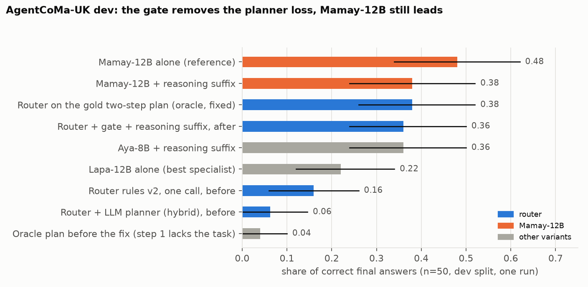
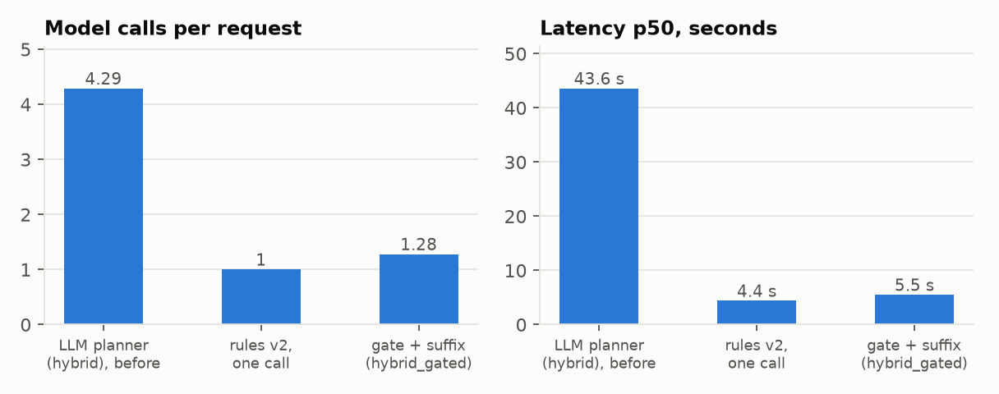
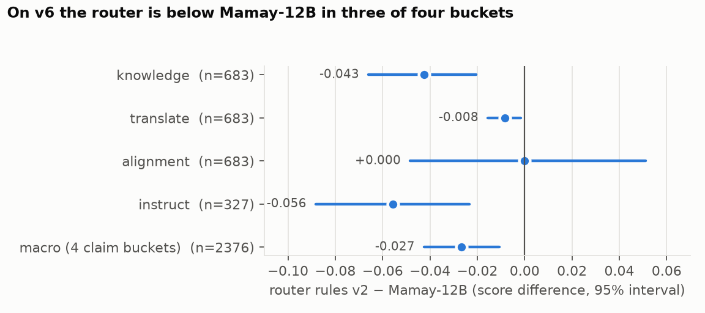
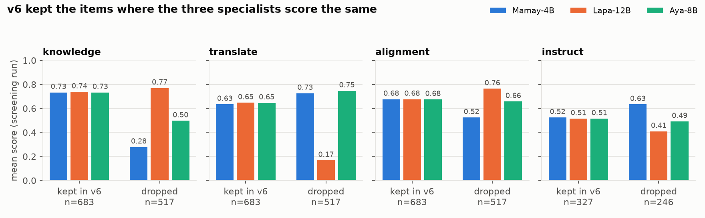

# Progress report 1 — 12 Oct 2026

Written in two voices: the student reports, the supervisor checks. Numbers
marked **dev** come from one run on a development split and are not thesis
claims.

## Goal

A router over small Ukrainian specialists (Mamay-4B, Lapa-12B, Aya-8B) that is
useful in practice. "Useful" is measured against one large model, Mamay-12B:

| Target | Measure | Where |
|---|---|---|
| Match or beat Mamay-12B on single-skill requests | score difference with paired bootstrap 95% interval | unbiased sample of the screening pool (v7, to build) |
| Close the gap on tasks that need reasoning | share of correct final answers | AgentCoMa-UK, dev 50 then test 150 once |
| Do not waste calls | model calls per request, p50 latency | same runs |
| Do not plan when no plan is needed | share of single-skill requests split into steps | v6 sample, manual cases |

## What was done (10–12 Oct)

1. Brought the stack up on the lab (three specialists, later Mamay-12B) and ran
   the debug UI against live models.
2. Ran 60 manual cases through the debug API (single-skill, composite, routing,
   parameters). Rows: `logs/manual_cases_20261012.jsonl` (local).
3. Reproduced the "gift for father" problem: the `hybrid` planner split all five
   single-skill requests into 2–3 steps and added translation, JSON or Python
   that nobody asked for.
4. Found the causes in `router/planner.py`: the prompt says "split into 2–4
   steps" and offers no one-step answer; its only example (translate → code,
   "return only a python block") is copied into unrelated plans.
5. Added planner profile `hybrid_gated`: decide "one task or several" first; one
   task is answered in one call on the user's own words; numeric word problems
   skip the planner by rule and get a short reasoning suffix; multi-step plans
   carry the original request in every step. Profiles `hybrid`, `template` and
   rules v2 are unchanged.
6. Ran AgentCoMa-UK dev (50) for the old planner, the stored oracle plan, the
   one-call router, each specialist alone, Mamay-12B alone, and the new profile.

## Results

### AgentCoMa-UK dev (n=50, one run, T=0, seed 42, max_tokens 1024) — dev

| System | Correct | 95% interval | Calls | p50 |
|---|---:|---|---:|---:|
| Mamay-12B alone (reference) | 0.48 | [0.34, 0.62] | 1 | — |
| Mamay-12B + reasoning suffix | 0.38 | [0.24, 0.52] | 1 | — |
| Aya-8B + reasoning suffix | 0.36 | [0.24, 0.50] | 1 | — |
| **Router, `hybrid_gated` (new)** | **0.32** | [0.20, 0.46] | 1.1 | 5.7 s |
| Lapa-12B alone (best specialist) | 0.22 | [0.12, 0.34] | 1 | — |
| Router rules v2, one call | 0.16 | [0.06, 0.26] | 1 | 4.4 s |
| Router + `hybrid` planner (old) | 0.06 | [0.00, 0.15] | 4.3 | 43.6 s |
| Oracle plan before the fix | 0.04 | [0.00, 0.10] | 2 | 5.2 s |

Latency is given only for the three runs made with the same sequential runner.

Paired differences (bootstrap, 95%):

| Comparison | Difference | Interval | Verdict |
|---|---:|---|---|
| `hybrid_gated` − `hybrid` planner | +0.23 | [+0.12, +0.35] | better |
| `hybrid_gated` − router rules v2 | +0.16 | [0.00, +0.32] | not distinguishable |
| `hybrid_gated` − Mamay-12B | −0.16 | [−0.32, 0.00] | not distinguishable |
| Mamay-12B − router rules v2 | +0.32 | [+0.16, +0.48] | Mamay-12B better |
| Mamay-12B + suffix − Mamay-12B | −0.10 | [−0.24, +0.06] | not distinguishable |





Any small-model variant solved 29 of 50 items; adding Mamay-12B raises that to
35. Five items were solved by Mamay-12B only.

### Manual cases

| Group | `hybrid` (old) | `hybrid_gated` (new) |
|---|---|---|
| 5 single-skill requests | 5 of 5 split into 2–3 steps; 4 of 5 answers wrong or off-format | 5 of 5 answered in one call |
| 3 composite requests | 1 good, 1 acceptable, 1 wrong | 2 good, 1 wrong (step 2 reviews the text instead of explaining the code) |

### v6 (frozen claim suite, existing runs)

Router rules v2 against Mamay-12B, macro over the four claim buckets:
−0.027 [−0.042, −0.011]. Against each specialist alone: not distinguishable.



## Supervisor review

### 1. The v6 suite is selected the wrong way round

`scripts/curate_discriminative_suite.py` sorts each bucket by variance,
highest first, then keeps `pool[drop_n:]`. That drops the 43% of items with
the **highest** between-model variance and keeps the lowest. The docstring and
`docs/mixed_ua_v6.md` say the opposite.

Check on the screening scores (`results/analysis/v6_selection_check.json`):

| Bucket | Share of items where all three specialists get the same score: kept in v6 | dropped |
|---|---:|---:|
| knowledge | 0.991 | 0.002 |
| translate | 0.092 (mean variance 0.002) | 0.002 (0.098) |
| alignment | 0.999 | 0.379 |
| instruct | 0.939 | 0.000 |



Consequences:

- On v6 the three specialists are the same system by construction, so "router
  not distinguishable from any specialist" and "route oracle tops out at 0.660"
  say nothing about routing. Both statements must be withdrawn.
- Mamay-12B was not used for selection, so it keeps its natural advantage. The
  −0.027 gap is biased against the router. Its sign may still be right; its
  size is not known.
- On the dropped items the specialists differ a lot (knowledge: Lapa 0.77,
  Aya 0.50, Mamay-4B 0.28; translate: Aya 0.75, Lapa 0.17). On the full
  screening pool the route oracle is 0.85 / 0.73 / 0.79 / 0.68 for knowledge /
  translate / alignment / instruct, against the best single specialist at
  0.75 / 0.69 / 0.71 / 0.57. Routing has room there.
- These screening scores predate the 29 Sep scorer fix and the replaced
  translate references (85 items). They must be rescored before any use.

Required: a suite sampled without looking at model scores (stratified random
from the 4237-item pool), then every system run on it once. A Mamay-12B run on
the full pool was started on 12 Oct (`results/pool_mamay12_20261012/` on the
lab); the earlier screening pass for that model had failed with HTTP 0.

### 2. The stored AgentCoMa oracle plan is broken

In `benchmarks/agentcoma_uk_200_composite.jsonl` the first oracle step
("filter") does not contain the task text, and the second step asks for "only
the number, no explanation". The filter model answers about an invented class
of students on every item. Source: `scripts/build_agentcoma_benchmark.py`.
Every earlier AgentCoMa "oracle" number is invalid and `plan_match` is measured
against a plan that cannot work.

### 3. Objections to the student's own results

- The reasoning suffix and the word-problem rule were written and measured on
  the same 50 dev items. The rule now matches 47 of 50. Expect a smaller effect
  on test. The test split (150) is untouched and must be run once, after freeze.
- n=50 gives intervals of about ±0.14. Two of the three headline comparisons
  touch zero. Do not write "the gate improves the router"; write "removes the
  planner loss".
- The suffix helps the 8B models and seems to hurt Mamay-12B. It is a patch for
  weak models, not a general method.
- Mamay-4B ran at `gpu_memory_utilization=0.55` on a shared card, and the
  variant script ran four requests at a time. No latency or VRAM figure from
  these days is comparable with the ledger.
- The first gate (ask Mamay-4B "one task or several") failed on word problems:
  9 of 21 were still split. It was replaced by a regex. The thesis should say so.
- The manual cases are eleven hand-written prompts. They illustrate; they do
  not measure. The false-split rate needs the 400-item v6 sample
  (`scripts/analysis/planner_split.py`) rerun with `hybrid_gated`.
- One composite case got worse (code + explanation).
- Rules v2 routes natural phrasings to chat ("як сказати англійською…",
  ethical questions without the word "моральний"). The rules fit benchmark
  templates.
- `pytest`: 61 pass, 1 fails (`test_knn_profile_with_hash_artifacts`, missing
  `scikit-learn` in the local venv). No test covers `hybrid_gated` yet.

## Plan to finish

| # | Step | Output | Needs |
|---|---|---|---|
| 1 | Fix the curation script; build v7 as a stratified random sample of the pool, split dev/test; state that v6 is withdrawn and why | `benchmarks/mixed_ua_v7.jsonl`, note in `docs/mixed_ua_v6.md` | decision |
| 2 | Rescore screening runs with the current scorer; finish Mamay-12B on the pool; run router rules v2 on the pool | scores for 5 systems on the same items | ~5 h GPU, running |
| 3 | Router vs Mamay-12B on v7 test with intervals; route oracle; routing accuracy | the main thesis table | step 2 |
| 4 | Fix the AgentCoMa oracle plan, rebuild, rerun oracle on dev | valid planning ceiling | decision |
| 5 | Planner: rerun the 400-item false-split check with `hybrid_gated`; fix the code + explanation case; add tests | false-split rate before/after | 3 GPUs, ~1 h |
| 6 | Freeze router (commit hash), run AgentCoMa test 150 once for rules v2, `hybrid_gated`, Mamay-12B | composite claim | step 5 |
| 7 | Decide on escalation: send word problems to Mamay-12B (0.48 vs 0.32 dev) and report the extra GPU | one design row | decision |
| 8 | Mamay-27B FP8 on v7 test | second reference | 1 GPU |
| 9 | Update `key_takeaways.md`, `thesis_scope.md`, `conclusion.md`, HF card from the frozen tables | consistent docs | steps 3, 6 |

## Update, same day: v7 built, oracle plan fixed, second review

This section replaces the numbers above where they differ.

### mixed_ua_v7

`scripts/benchmarks/build_mixed_ua_v7.py`: every one of the 4237 pool items,
no score-based selection, random split inside bucket and source (seed 42,
sha1 `9f7145b626b2`). The 128 items shared with v4 are forced into dev. Items
that share text stay in one split (both directions of a FLORES or WMT-22
sentence pair, identical prompts).

| Split | knowledge | translate | alignment | instruct | chat | code | Total |
|---|---:|---:|---:|---:|---:|---:|---:|
| dev | 406 | 405 | 400 | 212 | 32 | 32 | 1487 |
| test | 794 | 795 | 800 | 361 | 0 | 0 | 2750 |

All chat and code items come from v4, so test has none; those two buckets
were appendix-only already. The curation script is fixed
(`keep_high_variance()`, with a test); `mixed_ua_v6.jsonl` is unchanged and
marked withdrawn in `docs/mixed_ua_v6.md`, both READMEs and `AGENTS.md`.

### v7 dev, first look

`results/analysis/v7_dev_preliminary.json`. The three specialists' 4 Sep runs
cover the whole pool (HTTP 200 on all 4237, same decoding) and were rescored
with the current scorer and references. On the v6 items these rescored runs
agree with the separate 14 Sep solo runs on at least 99.6% of item scores.
The router row is **simulated**: the rules v2 route applied to those scores,
baseline prompt, no live run. Test-split scores were not computed.

| Bucket (dev n) | Mamay-4B | Lapa | Aya | Rules v2 (simulated) | Route oracle |
|---|---:|---:|---:|---:|---:|
| knowledge (406) | 0.559 | 0.749 | 0.631 | 0.739 | 0.833 |
| translate (405) | 0.674 | 0.440 | 0.687 | 0.687 | 0.725 |
| alignment (400) | 0.620 | 0.703 | 0.678 | 0.703 | 0.788 |
| instruct (212) | 0.583 | 0.479 | 0.539 | 0.557 | 0.689 |
| macro of four | 0.609 | 0.593 | 0.634 | 0.672 | 0.758 |

Macro differences, bootstrap inside buckets, 95%:

| Comparison | Difference | Interval |
|---|---:|---|
| simulated rules v2 − Aya (best single specialist) | +0.038 | [+0.020, +0.056] |
| simulated rules v2 − Mamay-4B | +0.062 | [+0.043, +0.083] |
| simulated rules v2 − Lapa | +0.079 | [+0.062, +0.097] |
| route oracle − simulated rules v2 | +0.087 | [+0.072, +0.101] |

- Unlike v6, no single specialist is best everywhere, and the simulated router
  is above each of them on the macro. This is a dev number from a simulation;
  the claim needs a live router run on test and the Mamay-12B row.
- Instruct: 122 of 212 items are routed as "chat" to Aya (0.539) while
  Mamay-4B scores 0.583. Simulated router minus Mamay-4B: −0.026
  [−0.071, +0.017], not distinguishable. First routing fix to try, on dev.
- The learned kNN/classifier artifacts were trained on pool items that are now
  in v7 test. Retrain on v7 dev before any v7 use.

### AgentCoMa oracle plan

The first repair (a generic "name the relevant objects" filter that now saw
the task) gave 0.20 [0.10, 0.32]. Review showed the filter model only restated
the inputs. The filter step is now AgentCoMa's own commonsense sub-question
(`question_commonsense_uk`), the gold decomposition. Files
`benchmarks/agentcoma_uk_*_composite.jsonl` were rebuilt; only `oracle_plan`
changed.

| System (dev, n=50) | Correct | 95% interval | Calls | p50 |
|---|---:|---|---:|---:|
| Mamay-12B alone | 0.48 | [0.34, 0.62] | 1 | — |
| Router on the gold two-step plan (oracle) | 0.38 | [0.26, 0.52] | 2 | 7.8 s |
| Router, `hybrid_gated`, tightened rule | 0.36 | [0.24, 0.50] | 1.28 | 5.5 s |
| Router rules v2, one call | 0.16 | [0.06, 0.26] | 1 | 4.4 s |
| Router + `hybrid` planner (old) | 0.06 | [0.00, 0.15] | 4.3 | 43.6 s |

| Comparison | Difference | Interval | Verdict |
|---|---:|---|---|
| `hybrid_gated` − router rules v2 | +0.20 | [+0.04, +0.36] | better |
| `hybrid_gated` − `hybrid` planner | +0.27 | [+0.15, +0.40] | better |
| `hybrid_gated` − Mamay-12B | −0.12 | [−0.28, +0.04] | not distinguishable |
| oracle − `hybrid_gated` | +0.02 | [−0.14, +0.18] | not distinguishable |
| oracle − Mamay-12B | −0.10 | [−0.24, +0.04] | not distinguishable |
| oracle − router rules v2 | +0.22 | [+0.06, +0.38] | better |

The oracle filter step names an accepted answer on 46% of items (strict
string match, so this is a lower bound).

### Second supervisor review (what was checked, what was wrong)

| Check | Result |
|---|---|
| Does the inverted rule explain v6? | Yes. 683/683 knowledge, 682/683 alignment, 327/327 instruct and 663/683 translate v6 items lie in the lowest-variance 57% of the pool. |
| v7 leakage between dev and test | **Found and fixed.** First build: 2 identical prompts and 56 sentence pairs (one direction in dev, the other in test). Now 0 and 0. |
| Tracked score files contain prompts or answers | No. |
| Rescoring is reproducible | Yes, ≥99.6% identical item scores against the independent solo runs. |
| Same config, two runs, T=0, seed 42 | **Not deterministic.** Text differed on 20 of 50 items, score on 3 of 50. On dev-50 a difference of up to about 0.06 can be rerun noise on top of the interval. |
| Word-problem rule on ordinary questions | **Too wide, fixed.** It fired on "Який фільм 2020 року порадиш?". The new rule needs a quantity question and two numbers; it fires on 44 of 50 AgentCoMa dev items, 0 of 1487 v7 dev items and none of 6 ordinary probes. |
| Planner repair path | **Bug fixed.** A repaired plan did not get the original request. |
| Tests for `hybrid_gated` | Added four; suite is 66 pass, 1 fail (missing `scikit-learn`). |
| Mamay-12B pool run | Healthy at 950 rows: all HTTP 200, no empty answers. |

Statements in this report that are withdrawn:

- "With the gold two-step plan the specialists do worse than one call." False.
  That came from my own weak filter prompt. With the dataset's sub-question the
  two-step plan (0.38) is level with one call plus the suffix (0.36).
- "`hybrid_gated` − rules v2: not distinguishable." With the tightened rule the
  interval is [+0.04, +0.36]. One run each; see the noise row above.

Open objections:

- The rule and the suffix are still tuned on the 50 dev items they are scored
  on. Only the untouched 150 test items can settle the size of the effect.
- `results/analysis/v6_selection_check.json` reports whole-pool and "dropped"
  means for the specialists. Those aggregates include items that are now v7
  test (old scorer). No routing decision was taken from them, but the test
  split has been looked at in aggregate once. From here on, dev only.
- While editing `router/planner.py` I cut out a block (two prompts and
  `extract_json_object`) by mistake; tests caught it and the block was restored
  from git. The diff against HEAD is additions plus one changed line.
- The simulated router is not the router: it ignores the alignment few-shot
  prompt and live routing of long prompts. A live rules v2 run on v7 dev is
  needed before any tuning is judged.
- One composite manual case (code + explanation) is still worse than before.

## Router experiments on v7 dev (12 Oct, evening)

Summary file: `results/analysis/v7_dev_router_experiments.json`. All on dev,
one run each.

| Idea | What was tried | Result | Verdict |
|---|---|---|---|
| Per-stratum route table | Best specialist per source (ZNO subject, ARC, MMLU, Belebele, translation direction, UAlign subset) | Rules v2 already pick the best specialist in every stratum except instruct/IFEval (Mamay-4B 0.548 vs routed 0.518) and WMT-22 en→uk (Lapa 0.558 vs Aya 0.522) | about +0.01 macro at most |
| Confidence cascade | First-token probability from each model (806 knowledge and alignment items); choose the model with the highest calibrated expected accuracy; two-fold on dev | Three specialists: −0.015 [−0.032, +0.002] knowledge, −0.033 [−0.058, −0.007] alignment against "always Lapa" | dropped |
| Confidence cascade with Mamay-12B | Same, Mamay-12B added; also "Mamay-12B when sure, else Lapa" | Not above Mamay-12B alone in either bucket | dropped |
| Verify-and-fix second pass on instruct | A model gets the request and Mamay-4B's draft and must fix violated constraints (212 items) | Mamay-4B fixing itself: −0.005 [−0.031, +0.022]. Lapa fixing: −0.019 [−0.050, +0.012]. Aya fixing: −0.063 [−0.111, −0.015] | dropped |

Why the confidence idea fails: Lapa gives ≥0.99 to its first token on 374 of
385 knowledge items while being right on 76% of them, so its confidence carries
no information. Mamay-12B is well calibrated (29% right below 0.5 confidence,
98% at ≥0.99), but the specialists' errors on its unsure items are not
complementary enough.

One observation to confirm with the full run: on v7 dev knowledge the
first-token answers of Lapa (0.751) and Mamay-12B (0.742) are level; on
alignment Mamay-12B is ahead (0.728 vs 0.700, baseline prompt).

Running on the lab: live rules v2 router on v7 dev with the alignment few-shot
prompt (`results/v7_dev_router/`), then the same with two worked examples per
bucket (`results/v7_dev_router_bucketfs/`), and Mamay-12B on the whole pool.

## Live runs on v7 dev and the planner gate (12 Oct, night)

### Router against Mamay-12B, v7 dev

`results/analysis/v7_dev_router_vs_mamay12.json`. Live runs, one pass, T=0,
seed 42, max_tokens 1024, HTTP 200 on every row. Router = rules v2 with the
alignment few-shot prompt. Mamay-12B got the same alignment prompt (0.738;
with the baseline prompt 0.730). Test split not scored.

| Bucket (n) | Router | Mamay-12B | Difference | 95% interval | Verdict |
|---|---:|---:|---:|---|---|
| knowledge (406) | 0.736 | 0.732 | +0.005 | [−0.032, +0.042] | not distinguishable |
| translate (405) | 0.686 | 0.698 | −0.011 | [−0.022, −0.001] | router lower |
| alignment (400) | 0.745 | 0.738 | +0.007 | [−0.025, +0.040] | not distinguishable |
| instruct (212) | 0.553 | 0.673 | −0.120 | [−0.175, −0.067] | router lower |
| macro of four | 0.680 | 0.710 | −0.030 | [−0.048, −0.012] | router lower |

- The gap to Mamay-12B is the instruct bucket. Without it the router is level
  on knowledge and alignment and 0.011 lower on translate.
- Router against the best single specialist (Aya) on the macro: +0.046
  [+0.025, +0.069]. On an unbiased suite routing does pay.
- Two worked examples per bucket made the router worse: −0.014
  [−0.027, −0.001] on the macro, −0.032 on knowledge. Dropped.
- Latency from these runs is not usable: other jobs shared the models.

### Planner gate after the fixes

`results/analysis/planner_gate_dev.json`.

| Check | Old `hybrid` | `hybrid_gated` |
|---|---:|---:|
| Single-skill requests split into steps (400 from v7 dev) | 0.68 [0.64, 0.73] | 0.035 [0.021, 0.058] |
| Composite requests that get a plan (composite v2 dev, 60) | — | 60 of 60 |
| … with the gold intent sequence | — | 46 of 60 |
| … with the gold model sequence | — | 57 of 60 |

Changes since the first version of the gate: the last step sees every earlier
result and must give the whole answer (the executor returns the last step
only, so "write a function and explain it" used to lose the function);
intent definitions are back in the prompt; near-miss intent labels
("classification", "instruction") are mapped to the allowed six instead of
rejecting the plan; a request that demands one letter or digit skips the
planner by rule.

Supervisor notes: the prompt went through four versions on these two dev sets
(false split 0.09 → 0.21 → 0.03 → 0.035; plans built 52 → 56 → 46 → 60), so
the numbers are tuned-on. The one-symbol rule matches the benchmark wording
("Відповідь — лише літера"), like the rules v2 patterns. Remaining false
splits are all in instruct (14 of 100). Composite v2 test (60) and AgentCoMa
test (150) are untouched.

### Instruct routing profile `v3_instruct` (13 Oct, offline)

`results/analysis/v7_dev_instruct_profile.json`. New rules profile: rules v2
plus one rule that sends an unmatched "write a …" request to Mamay-4B as
instruct instead of to Aya as chat. Rules v2 is unchanged. Estimated from the
stored baseline-prompt specialist scores, **dev rows only**; a simulation, not
a live run (the live rules v2 router scored 0.553 on dev instruct).

| Bucket (dev n) | Rules v2 | `v3_instruct` | Difference | 95% interval | Items rerouted |
|---|---:|---:|---:|---|---:|
| instruct (212) | 0.557 | 0.563 | +0.006 | [−0.030, +0.041] | 80 |
| chat (32, appendix) | 0.875 | 0.922 | +0.047 | [0.000, +0.109] | 18 |
| knowledge, translate, alignment, code | same | same | 0 | — | 0 |
| macro of four | 0.672 | 0.673 | +0.001 | [−0.008, +0.010] | |

Not distinguishable from rules v2 on instruct and on the macro. The profile is
**not recommended**: it moves 80 instruct items to the specialist that is
better on the bucket average and gains nothing measurable, and it also moves
18 of 32 chat items. The instruct gap to Mamay-12B (−0.120) is not a routing
problem among these three models. The profile stays in the code as a recorded
negative result.

## Files

- Figures: `docs/figures/*.png`, built by `scripts/analysis/plot_progress_report.py`.
- Summaries: `results/analysis/agentcoma_dev_20261012_summary.json`,
  `results/analysis/v6_selection_check.json`,
  `results/analysis/v7_dev_preliminary.json`, `results/v7_pool/`.
- Code change: `router/planner.py` (profile `hybrid_gated`), not committed.
- Raw rows stay in `logs/` (local, not in git).

## Ready to freeze (13 Oct)

Nothing in this section has been run. The test splits are untouched.

### Proposed frozen configuration

| Part | Choice | File | Last commit that changed it |
|---|---|---|---|
| Routing | rules profile `v2` | `router/intent_rules.py` | `5bf829b` (added `v3_instruct` beside it; `v2` rules unchanged since before v7) |
| Alignment prompt | `--align-prompt fewshot` | `scripts/alignment_prompt_variants.py` | `11a1d0d` |
| Bucket few-shot | none (it made dev worse) | — | — |
| Planner | `hybrid_gated` | `router/planner.py` | `9dbb1b7` |
| Decoding | T=0, seed 42, max_tokens 1024, one pass on v7; 3 repeats on AgentCoMa | — | — |
| Specialists | Mamay-4B, Lapa-12B, Aya-8B, bf16, `gpu_memory_utilization` 0.90, one model per card | `cluster/serve_*.sbatch` | — |

To freeze: review this branch, then record the commit hash of its tip in the
ledger note of the test runs. No file may change between that hash and the
test runs.

### Decisions still open

| Decision | State |
|---|---|
| Use the `v3_instruct` profile | Not recommended: not distinguishable from `v2` on dev (+0.006 [−0.030, +0.041] on instruct). |
| Escalate word problems to Mamay-12B | Decided on 12 Oct: no. Mamay-12B is a reference baseline only. |
| Run the planner (`hybrid_gated`) on v7 test, or only one-hop rules v2 | Open. v7 items are single-skill, so the planner can only cost calls there; the dev false-split rate is 0.035. One-hop rules v2 is the comparable row to the solo models. |

### Jobs for the test runs

The v6 jobs are pinned to the v6 file and to the `results/v6_*` folders, so
they are not used. Two new jobs take the suite split as a variable, and the
AgentCoMa jobs now take `MAX_TOKENS` and `REPEATS` (old defaults kept).
**None of these has been run yet.** They pass `bash -n`; the first real check
is a dev-split run, which must reproduce the dev numbers in this report.

| Run | Job | Writes to |
|---|---|---|
| One model alone on v7 | `cluster/eval_v7_solo.sbatch` (`ALIAS`, `SPLIT`) | `results/v7_<split>_solos/` |
| Rules v2 router on v7 | `cluster/eval_v7_router.sbatch` (`SPLIT`) | `results/v7_<split>_router/` |
| AgentCoMa-UK, router systems | `cluster/eval_agentcoma_200.sbatch` (`SPLIT`, `SYSTEMS`, `REPEATS`, `MAX_TOKENS`) | `results/week_13_agentcoma_200_<split>/` |
| AgentCoMa-UK, one model alone | `cluster/eval_agentcoma_solo.sbatch` (`ALIAS`, `SPLIT`, `REPEATS`, `MAX_TOKENS`) | same folder, plus the step questions |

Step 1, dev check (safe to repeat; compare with the dev table above):

```bash
sbatch cluster/eval_v7_router.sbatch
sbatch --job-name=v7-mamay12 --export=ALL,ALIAS=mamay12 cluster/eval_v7_solo.sbatch
```

Step 2, test runs, once, after the freeze commit is recorded:

```bash
SPLIT=test sbatch cluster/eval_v7_router.sbatch
sbatch --job-name=v7-mamay12 --export=ALL,ALIAS=mamay12,SPLIT=test cluster/eval_v7_solo.sbatch
sbatch --job-name=v7-mamay4 --export=ALL,ALIAS=mamay4,SPLIT=test cluster/eval_v7_solo.sbatch
sbatch --job-name=v7-lapa --export=ALL,ALIAS=lapa,SPLIT=test cluster/eval_v7_solo.sbatch
sbatch --job-name=v7-aya --export=ALL,ALIAS=aya,SPLIT=test cluster/eval_v7_solo.sbatch
sbatch --job-name=v7-mamay27 --export=ALL,ALIAS=mamay27,SPLIT=test cluster/eval_v7_solo.sbatch
SPLIT=test SYSTEMS=router_direct,hybrid_gated,oracle REPEATS=3 MAX_TOKENS=1024 sbatch cluster/eval_agentcoma_200.sbatch
sbatch --job-name=ac-mamay12 --export=ALL,ALIAS=mamay12,SPLIT=test,REPEATS=3,MAX_TOKENS=1024 cluster/eval_agentcoma_solo.sbatch
```

The router job needs three cards and each solo job one; the node has four and
is shared, so these do not all fit at once. Submit the router job first.

Step 3, comparison with intervals (after the scored files are pulled back):

```bash
python scripts/analysis/v7_compare.py --split test --a results/v7_test_router/scores_router_detail.jsonl --b results/v7_test_solos/scores_mamay12_detail.jsonl
```

### Files to copy to the lab first

The lab `~/Diploma` is not a git checkout. Copy with `scp` and compare
checksums before any run:

| File | Why |
|---|---|
| `router/planner.py` | `hybrid_gated` profile |
| `router/intent_rules.py` | `v3_instruct` added; `v2` unchanged |
| `scripts/run_small_router_cluster.py` | new `--split` option |
| `cluster/eval_v7_solo.sbatch`, `cluster/eval_v7_router.sbatch`, `cluster/eval_agentcoma_200.sbatch`, `cluster/eval_agentcoma_solo.sbatch` | new and changed jobs |
| `benchmarks/mixed_ua_v7.jsonl` | claim suite (only the dev file is on the lab) |
| `benchmarks/agentcoma_uk_200_composite.jsonl` | rebuilt with the fixed oracle plan; local only, never in git |
| `scripts/build_progress_ledger.py`, `tests/` | not needed for the runs |

Before submitting: `squeue -u $USER` and `nvidia-smi`. On 10–12 Oct card 0 was
partly used by another user, so a job that Slurm placed there failed at 0.90
utilisation.

### After the test runs

Score each repeat separately, add the runs to the ledger registry with the
frozen commit hash, rebuild the ledger, and compute every claimed difference
with a paired bootstrap interval. Then update `key_takeaways.md`,
`thesis_scope.md` and `conclusion.md` from those tables only.

