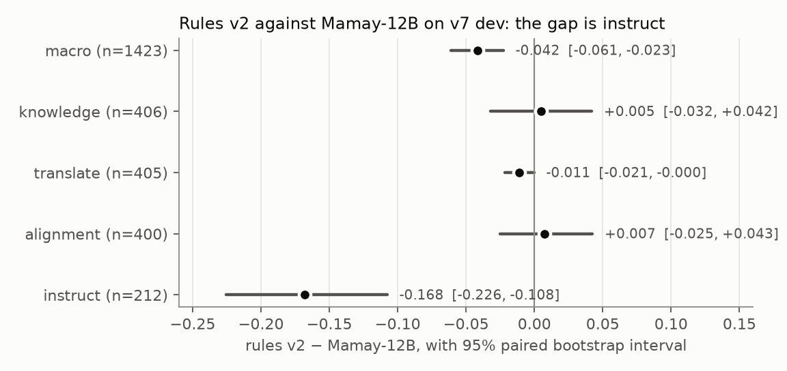
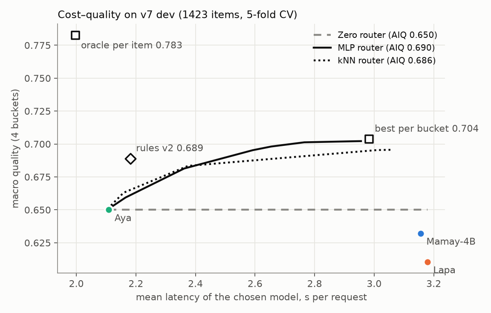
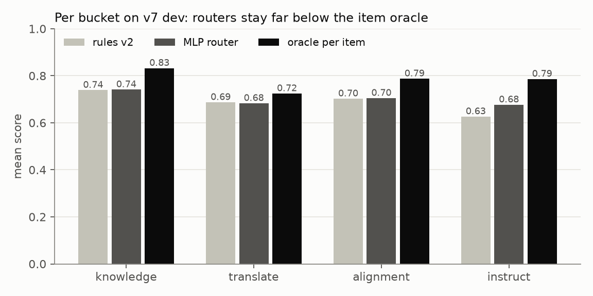
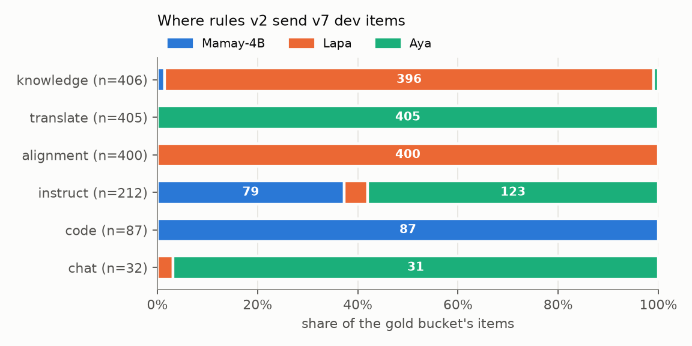

# Rules v2 router

The default router of the project since 21 Aug 2026. It reads the request text, finds
its intent with keyword rules and sends it to one of three small specialists. Code:
[`router/intent_rules.py`](../router/intent_rules.py), profile `v2` (the default of
`route_intent`). History of the change from v1: [`week_7_rules_v2.md`](week_7_rules_v2.md).

## 1. Routing table

| Intent | Model | Served as | Why this model |
|---|---|---|---|
| translate | Aya Expanse 8B | `aya`, port 8005 | best translate score on v4 (0.821) |
| alignment | Lapa 12B | `lapa`, port 8001 | 0.750 with the few-shot prompt on v4 |
| instruct | Mamay-4B | `mamay4`, port 8003 | Ukrainian instruction following; tied with Aya on v4 (0.781) |
| code | Mamay-4B | `mamay4`, port 8003 | 0.984 on v4 against Qwen-Coder-7B 0.969 |
| knowledge | Lapa 12B | `lapa`, port 8001 | +0.16 over Mamay-4B in the v4 bake-off |
| chat (no rule matched) | Aya Expanse 8B | `aya`, port 8005 | 1.000 on v4 chat against Mamay-4B 0.984 |

The table copies the best model per gold bucket on `mixed_ua_v4`
(`BEST_BY_BUCKET`). Qwen-7B is in the pool but no v2 rule sends anything to it.
v1 differed in two cells: code went to Qwen-Coder-7B and chat to Mamay-4B.

## 2. How a request is routed

1. If the planner gives an intent hint for a step, that intent is used and no rule is read.
2. Otherwise the rules are tried in this order; **the first match wins**:

   | Order | Intent | What the rule looks for (shortened) |
   |---:|---|---|
   | 1 | translate | «переклад…», «translate this/from/into», «Переклади з англійської» |
   | 2 | alignment | «моральн…», «етичн…», «(не)прийнятн…», «відповідай лише цифрою», «погано/добре … 0/1/2» |
   | 3 | instruct | strong format markers: «рівно», «exactly», «Поверни ТІЛЬКИ», «Відповідай ЛИШЕ», «ВЕЛИКИМИ ЛІТЕРАМИ», «одним словом», «оформи … json», «покроково» |
   | 4 | code | «python», «sql», «функція», «напиши … код», three backticks, «Тільки код» |
   | 5 | knowledge | question openers at the start of a line («Яка», «Хто написав», «Скільки»), «що таке», «коли», «ЗНО», «Варіанти:», years 2024 to 2039 |

3. If nothing matches, the request is chat and goes to Aya.
4. If a model pool is given and the chosen model is not in it, the first available of
   Aya, Mamay-4B, Lapa, Qwen-7B is used.

Why the order matters: instruct sits above knowledge and code, so that a format task
that mentions a year or says «Поверни ТІЛЬКИ … python» stays instruct. Instruct uses
only strong markers; bare «тільки» used to pull ZNO passages and «Тільки код» prompts
into instruct.

## 3. Prompt changes that go with the router

| Change | Where | When it applies |
|---|---|---|
| Few-shot alignment prompt | `scripts/alignment_prompt_variants.py`, `--align-prompt fewshot` | social 0/1/2 items only: the scale is spelled out (1 = ordinary behaviour, not praise) and three examples are given. Ethics 0/1 items are unchanged. Always on in the evaluation protocol and in the demo page. |
| Reasoning suffix (removed 2 Nov 2026) | was `router/planner.py`, `THINK_SUFFIX` | single-call numeric word problems in the composite runs, found by a regex; removed with the planner's rule gates, so no rule changes a prompt before the planner LLM sees it. |

## 4. Other profiles in the same file

| Profile | What it changes | Status |
|---|---|---|
| `v1` | code → Qwen-7B, chat → Mamay-4B | superseded by v2 |
| `v2_llm` | v2 rules first; an unmatched request is classified by Mamay-4B | right intent on everyday requests 0.36 → 0.85 (`results/analysis/intent_natural_eval.json`) |
| `llm` | no keyword rules; Mamay-4B names the intent of every request | demo option |
| `knn`, `clf` | learned label from the prompt embedding | old artifacts trained on items now in v7 test; not used. Replaced by the RouterBench-style evaluation in `scripts/analysis/routerbench_dev.py` |

## 5. Results

Figures: `scripts/analysis/plot_routerbench_dev.py` → `docs/figures/`.

### v4 (development suite, 192 items × 3 repeats)

| System | Overall | p50, ms | Note |
|---|---:|---:|---|
| Rules v2 + few-shot, bf16 | 0.848 | 633 | 21 Aug, before the 29 Sep scorer fix (probably about 0.01 low) |
| Best model per gold bucket | 0.848 | 633 | same map, reads the gold bucket |
| Rules v2 + few-shot, FP8, one GPU | 0.852 | 723 | rescored 29 Sep |
| Mamay-12B alone | 0.884 | 1352 | rescored 29 Sep |

On v4 the rules reach the gold-bucket ceiling, so the table has no headroom left there.

### v7 dev (1423 items, four headline buckets, one pass, live router)

| Bucket | Rules v2 | Mamay-12B | Difference [95%] |
|---|---:|---:|---|
| knowledge | 0.737 | 0.732 | +0.005 [−0.032, +0.042], not distinguishable |
| translate | 0.686 | 0.698 | −0.011 [−0.021, −0.000], lower |
| alignment | 0.745 | 0.738 | +0.008 [−0.025, +0.043], not distinguishable |
| instruct | 0.622 | 0.790 | −0.168 [−0.226, −0.108], lower |
| **macro** | **0.697** | **0.739** | **−0.042 [−0.061, −0.023], lower** |

Source: `results/analysis/v7_dev_router_vs_mamay12.json`. Dev only; v7 test is not run.

Offline on the same dev items with pool scores (no few-shot), from
`results/routerbench_v7dev/summary.json`:

| System | Macro |
|---|---:|
| Aya alone (best single specialist) | 0.650 |
| Rules v2 (simulated) | 0.689 |
| Best model per gold bucket | 0.704 |
| MLP router (RouterBench style) | 0.702 |
| Best model on each item (oracle) | 0.783 |

Rules v2 − Aya: +0.039 [+0.020, +0.057].

At its own latency (2.18 s) rules v2 sits above both learned curves (0.661 for MLP and 0.665 for kNN there); the learned routers reach its quality only by sending more items to the slower Lapa and Mamay-4B.

## 6. Where the rules go wrong

Routing of v7 dev items by gold bucket:

| Gold bucket | n | Mamay-4B | Lapa | Aya | Main error |
|---|---:|---:|---:|---:|---|
| knowledge | 406 | 6 | 396 | 4 | — |
| translate | 405 | 0 | 0 | 405 | — |
| alignment | 400 | 0 | 400 | 0 | — |
| instruct | 212 | 79 | 10 | 123 | 122 match no rule and go to Aya as chat |
| code | 87 | 87 | 0 | 0 | — |
| chat | 32 | 0 | 1 | 31 | — |

- **Instruct is the whole gap.** Most v7 instruct items state their format in words the
  strong-marker rule does not list, so they fall through to chat. On dev, Mamay-4B
  scores 0.676 on instruct and Aya 0.605.
- **Bucket, not item.** The table picks one model per intent. The best model on each
  item would score 0.783 against 0.704 for the best model per bucket. Neither the rules
  nor the learned kNN/MLP routers find which items a model gets wrong.
- **Keyword rules are brittle.** Everyday requests without the expected words are
  misread (0.36 right intent on `intent_requests_72`). Decided 27 Oct 2026: no new
  regular-expression rules for routing or planning; fixes go through prompts, a model
  classifier (`v2_llm`) or learned routing.
